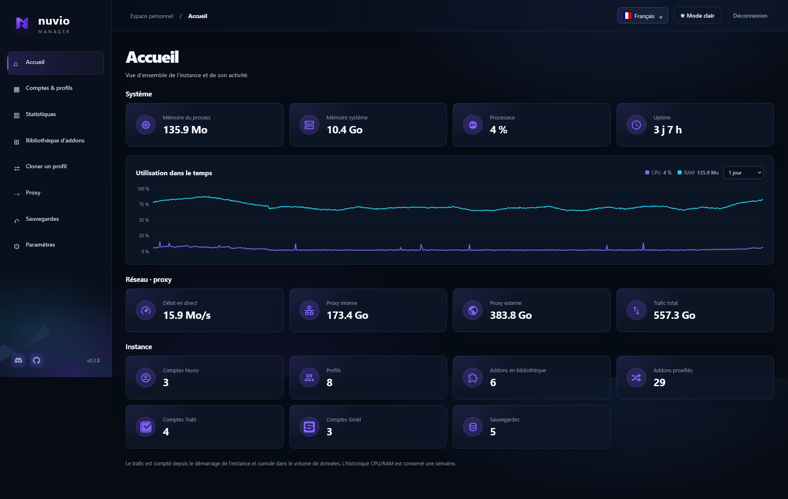
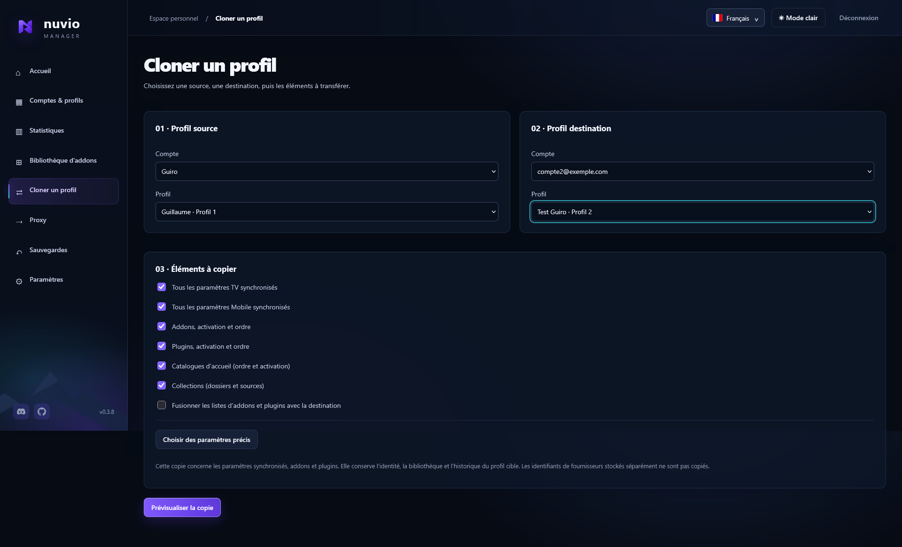
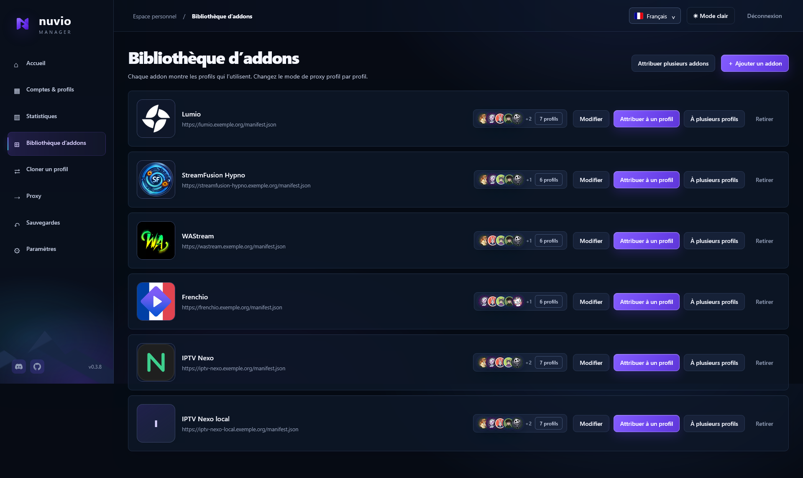
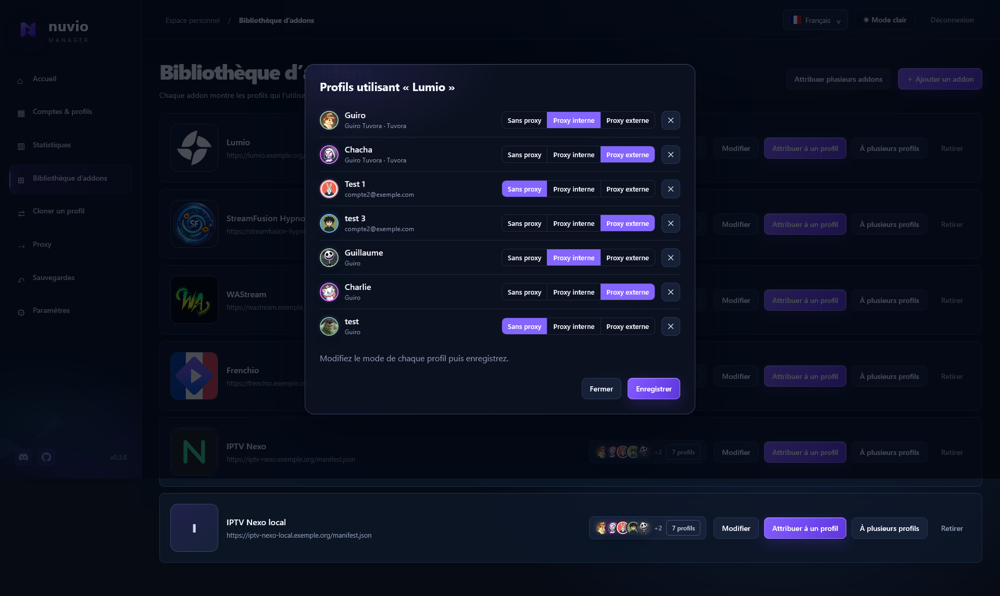
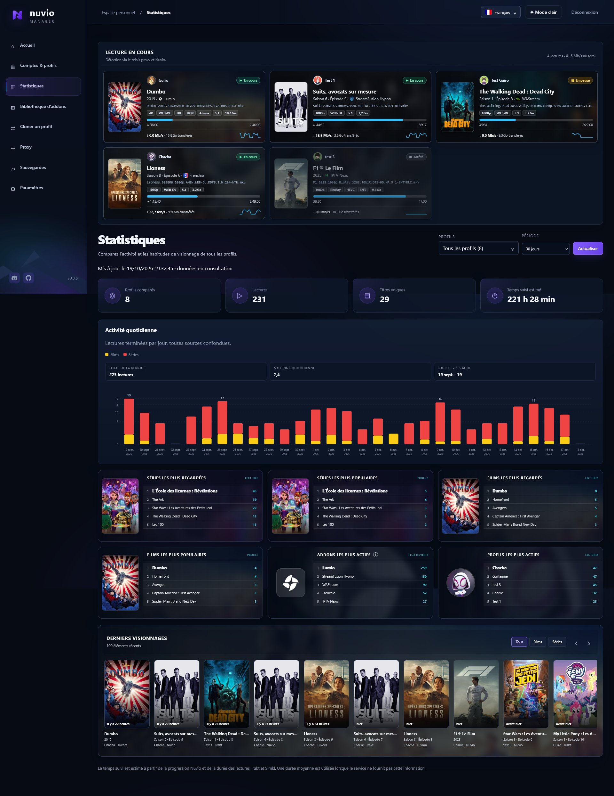
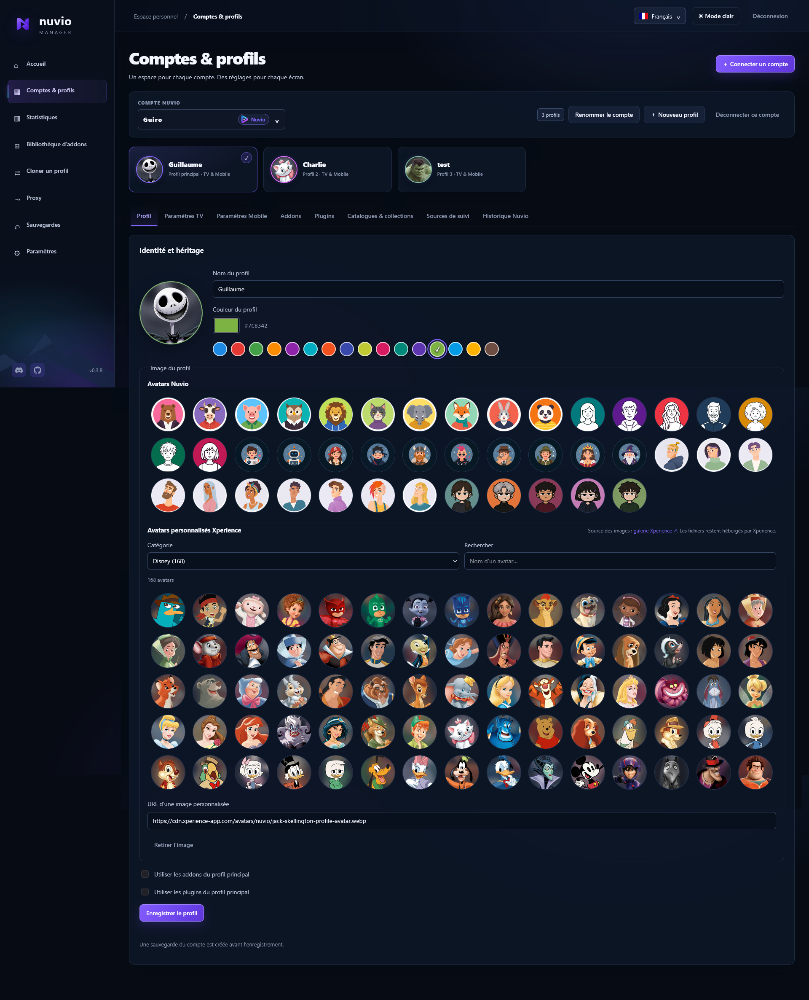
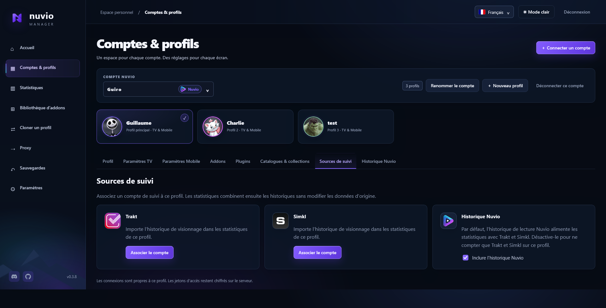
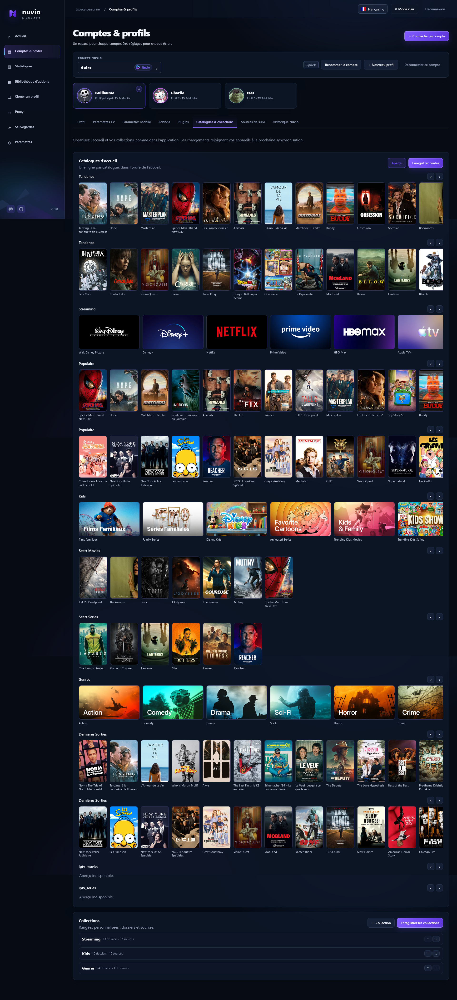

# Nuvio Manager

Dashboard auto-hébergé pour gérer plusieurs comptes et profils [Nuvio](https://nuvio.tv), ainsi que les comptes [Tuvora](https://tuvora.co).

> Projet communautaire indépendant, non affilié à Nuvio ni à Tuvora.

## Aperçu

<table>
  <tr>
    <td width="50%" valign="top">
      <a href="docs/screenshots/accueil.png"></a>
      <br><sub><b>Accueil</b> — système, historique CPU/RAM, trafic du proxy et vue d’ensemble de l’instance.</sub>
    </td>
    <td width="50%" valign="top">
      <a href="docs/screenshots/cloner-profil.png"></a>
      <br><sub><b>Clonage</b> — copie complète ou partielle d’un profil vers un autre, y compris entre comptes.</sub>
    </td>
  </tr>
  <tr>
    <td width="50%" valign="top">
      <a href="docs/screenshots/bibliotheque-addons.png"></a>
      <br><sub><b>Bibliothèque d’addons</b> — chaque addon avec les profils qui l’utilisent.</sub>
    </td>
    <td width="50%" valign="top">
      <a href="docs/screenshots/bibliotheque-modes-proxy.png"></a>
      <br><sub><b>Proxy par profil</b> — sans proxy, proxy interne ou externe (WARP), modifiables d’un coup.</sub>
    </td>
  </tr>
  <tr>
    <td width="50%" valign="top">
      <a href="docs/screenshots/statistiques.png"></a>
      <br><sub><b>Statistiques</b> — lectures en cours en direct (release, débit), activité quotidienne et classements.</sub>
    </td>
    <td width="50%" valign="top">
      <a href="docs/screenshots/profil-identite.png"></a>
      <br><sub><b>Profils</b> — identité, couleur et avatars Nuvio ou Xperience.</sub>
    </td>
  </tr>
  <tr>
    <td width="50%" valign="middle">
      <a href="docs/screenshots/profil-sources-suivi.png"></a>
      <br><sub><b>Sources de suivi</b> — Trakt et Simkl associés par profil, historique Nuvio inclus ou non dans les statistiques.</sub>
    </td>
    <td width="50%" valign="top" align="center">
      <a href="docs/screenshots/catalogues-apercu.jpg"></a>
      <br><sub><b>Catalogues & collections</b> — aperçu de l’accueil tel qu’il s’affiche dans l’application.</sub>
    </td>
  </tr>
</table>

## Fonctionnalités

### Comptes & profils

- Plusieurs comptes **Nuvio** et **Tuvora**, chacun avec plusieurs profils.
- Connexion Nuvio par appairage TV (code), Tuvora par e-mail + mot de passe. **Le mot de passe n’est jamais stocké.**
- Identité de profil : nom, couleur, avatar (galerie Nuvio ou Xperience), héritage des addons/plugins du profil principal.
- Interface multilingue : français, anglais, espagnol, allemand, italien.

### Réglages & contenu

- Réglages **TV** et **Mobile** par profil.
- **Catalogues d’accueil** : ordre d’affichage, activation, titres personnalisés.
- **Collections** : création et édition complète (dossiers, sources Addon / TMDB / Trakt), à l’image du dashboard officiel.
- **Bibliothèque d’addons** avec attribution par profil.

### Proxy d’addons intégré

- Relais **direct** (interne) ou via **proxy externe** HTTP, HTTPS, SOCKS4 ou SOCKS5 (compatible Cloudflare WARP).
- **URL de relais uniques par profil et révocables** : supprimer un compte ou retirer un addon coupe immédiatement le lien ; le clonage régénère des URL propres au profil cible.
- Compteurs de bande passante (interne / externe).

### Clonage de profils

- Copie **complète ou partielle** entre profils (réglages TV/Mobile, addons, plugins, catalogues, collections), y compris entre comptes et entre Nuvio et Tuvora.
- Garde-fous : sens de la copie affiché, avertissement en cas de perte de données, protection contre l’écrasement par une source vide.

### Suivi & statistiques

- Connexion facultative à **Trakt** et **Simkl** ; exclusion possible de l’historique Nuvio par profil.
- Historique, progression et bibliothèque par profil.
- **Statistiques** avec activité quotidienne cliquable (détail par jour : profils et contenus vus, fiches films/séries) et enrichissement **TMDB** (titres localisés, synopsis, affiches).

### Spécifique Tuvora

- **Playlists IPTV** par profil (Xtream, M3U, Stalker).
- **Guide des sports** : ligues et équipes suivies.

### Sauvegardes & données

- **Sauvegardes chiffrées** du compte avec restauration (et repli automatique si l’API refuse la restauration).
- Toutes les données locales (comptes, sessions, réglages, sauvegardes) sont **chiffrées au repos**.

### Interface & exploitation

- Tableau de bord d’accueil : mémoire, processeur, disponibilité, bande passante et état réseau/proxy.
- Thème sombre et clair.
- Version du manager affichée dans la barre latérale (clic vers le commit) et liens Discord et GitHub.
- Images Docker multi-architecture (AMD64 / ARM64).

## Installation avec Docker

```sh
git clone https://github.com/Guiro28/nuvio-manager.git
cd nuvio-manager
docker compose pull
docker compose up -d
docker logs nuvio-manager
```

Ouvrir ensuite :

```text
http://ADRESSE-DU-SERVEUR:3100
```

Au premier démarrage, l’administrateur peut être créé de deux façons :

- **Depuis le `compose`** (recommandé, notamment derrière une authentification externe) en définissant les variables d’environnement :

  ```yaml
  environment:
    ADMIN_USERNAME: admin
    ADMIN_PASSWORD: change-moi-12-caracteres-minimum   # 12 caractères minimum
    PUBLIC_URL: https://manager.example.com            # adresse publique HTTPS (= hôte de confiance)
    # DISABLE_LOGIN: "true"                            # désactive la page de connexion (voir ci-dessous)
  ```

  Quand l’administrateur est défini par l’environnement, sa modification est masquée dans les paramètres.

  Ces valeurs sont appliquées à chaque démarrage (elles priment sur la configuration stockée) : le dashboard s’ouvre déjà configuré, sans écran de première configuration.

- **Sinon, à la première ouverture**, le dashboard demande le nom d’utilisateur, le mot de passe de l’administrateur et l’adresse publique. (Il n’y a plus de code de configuration.)

Le mot de passe de l’administrateur n’est jamais stocké en clair.

## Variante avec WARP

Pour lancer Nuvio Manager avec un conteneur Cloudflare WARP :

```sh
docker compose -f compose.warp.yaml pull
docker compose -f compose.warp.yaml up -d
```

Dans **Paramètres > Proxy externe**, utiliser :

```text
socks5://warp:1080
```

Le dashboard accepte également les proxys HTTP, HTTPS, SOCKS4 et SOCKS5 hébergés localement ou à distance.

## Reverse proxy

Pour utiliser un domaine HTTPS, placer Caddy, Nginx ou Traefik devant le port `3100`, puis enregistrer le domaine dans **Paramètres > Adresse publique**.

Exemple Caddy :

```caddy
manager.example.com {
    reverse_proxy 127.0.0.1:3100
}
```

Le reverse proxy doit transmettre l’en-tête `Host` d’origine (ou `X-Forwarded-Host`, également accepté). Renseigne le domaine dans `PUBLIC_URL` : son hôte devient automatiquement l’hôte de confiance.

### Derrière une authentification externe (OAuth)

Le manager fonctionne derrière un portail OAuth (oauth2-proxy, Authelia, Authentik, Cloudflare Access…). À la première ouverture, l’assistant de configuration demande le mode d’**authentification** :

- **Interne** — le manager a sa propre page de connexion (recommandé en accès direct).
- **Externe** — derrière oauth2-proxy, Authelia… : le manager fait confiance à l’identité injectée par le proxy (`X-Auth-Request-User` / `X-Forwarded-User`) et entre directement en administrateur, tout en gardant le login local en repli (pas de double connexion).

Ce choix est modifiable ensuite dans **Paramètres > Authentification externe**. Pour éviter l’écran de configuration initial (que l’OAuth peut bloquer), tu peux aussi définir `ADMIN_USERNAME`, `ADMIN_PASSWORD` et `PUBLIC_URL` dans le `compose` : le dashboard démarre déjà configuré.

Ces deux variables d’environnement restent disponibles (et verrouillent le réglage) pour un déploiement automatisé :

- **`AUTH_PROXY: "true"`** : équivaut au mode « Externe ». Restreins les sources avec `TRUST_PROXY_IPS` (IPs/CIDR, défaut : boucle locale + réseau privé).
- **`DISABLE_LOGIN: "true"`** : supprime complètement la page de connexion du manager (délégation totale). ⚠️ À n’utiliser **que** derrière une authentification externe : sans page de connexion, toute personne pouvant atteindre le dashboard y a un accès administrateur complet.

Le relais d’addons public `/relay/**` doit être exempté du proxy d’auth (sinon les addons proxyfiés ne fonctionnent plus) : utilise `--skip-auth-route=^/relay/`, un routeur dédié, ou expose-le séparément via `RELAY_PORT`. Évite aussi d’appliquer un middleware qui réécrit les réponses 401/403 du manager.

Configuration détaillée (Traefik ForwardAuth + oauth2-proxy, cookies, dépannage) : [docs/oauth2-proxy.md](docs/oauth2-proxy.md).

## Mise à jour

```sh
git pull
docker compose pull
docker compose up -d
```

Avec WARP :

```sh
git pull
docker compose -f compose.warp.yaml pull
docker compose -f compose.warp.yaml up -d
```

## Développement local

Nécessite Node.js 24 ou supérieur.

```sh
npm ci
npm run dev
```

Le dashboard est disponible sur [http://localhost:3100](http://localhost:3100).

Lancer les tests :

```sh
npm test
```

## Données

Les comptes, sessions, réglages et sauvegardes sont conservés dans le volume Docker `manager-data`. Conservez ce volume lors des mises à jour ou migrations.

Les images Docker sont publiées pour les architectures AMD64 et ARM64 :

```text
ghcr.io/guiro28/nuvio-manager:latest
```
